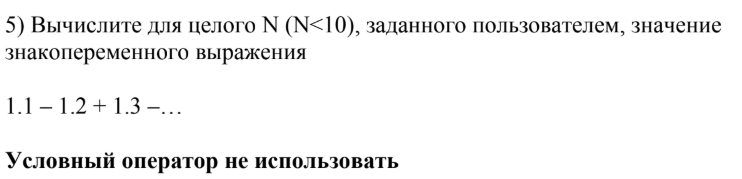
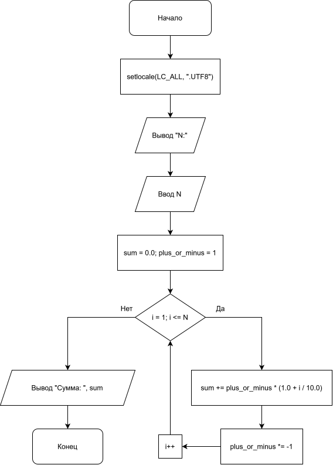

# Лабораторная работа №8
---

## 1. Вариант

**Вариант 5**

---

## 2. Условие задачи



---

## 3. Блок-схема

* **Блок-схема:**
  <p align="center">
  
</p>

---

## 4. Реализация программы

```c
#include <stdio.h>
#include <locale.h>

int main() {
    setlocale(LC_ALL, ".UTF8");


    int N;

    printf("N:\n");
    scanf("%d", &N);

    double sum = 0.0;
    int plus_or_minus = 1;

    for (int i = 1; i <= N; i++) {
        sum += plus_or_minus * (1.0 + i / 10.0);
        plus_or_minus *= -1; 
    }
    printf("Сумма: %lf\n", sum);

    return 0;
}
```

---

## 5. Результат работы программы

**Входные данные:**

***Ввод 1***
```text
N = 9
```
***Ввод 2***
```text
N = 4
```

**Консольный вывод:**

***Вывод 1:***
```text
Сумма: 1,500000
```
***Вывод 2***
```text
Сумма: -0,200000
```
---

## 6. Информация о разработчике

*Бурыкин Александр бТИИ-262*
